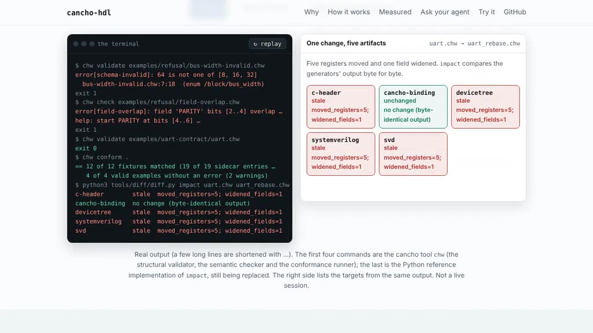

# cancho-hdl

**One file for the software/hardware boundary, checked and generated everywhere.**

A register map lives in the RTL, a spreadsheet and a datasheet; the C header,
the device tree and the driver repeat it by hand, and every copy drifts.
cancho-hdl declares the boundary once, in a `.chw` contract, refuses
contradictions with a structured diagnostic, and generates the copies: a C
header, Cancho bindings, a device-tree fragment, SystemVerilog register RTL and
CMSIS-SVD.

```
$ chw parse examples/refusal/parse-error.chw                 # the cancho parser
error[parse-error]: parse error: expected ':' after the register offset (before the access kind), found 'RW'.  examples/refusal/parse-error.chw:2:26

$ chw validate examples/refusal/bus-width-invalid.chw        # the cancho validator
error[schema-invalid]: 64 is not one of [8, 16, 32]  examples/refusal/bus-width-invalid.chw:7:18  (enum /block/bus_width)

$ chw check examples/refusal/field-overlap.chw               # the cancho checker
error[field-overlap]: field 'PARITY' bits [2..4] overlap with ENABLE bits [0..3] in register 'CTRL'.
   --> examples/refusal/field-overlap.chw
   = related[field-overlap]: field 'ENABLE' occupies bits [0..3] in register 'CTRL'.
help: start PARITY at bits [4..6] (just after ENABLE, bits [0..3]), or shrink / move either field — the toolchain cannot say which side the hardware semantics live on
exit 1
```

[](docs/demo/hdl-demo.mp4)
*A 24-second recording of the project page's replay of real `chw` output, not a live session. Re-record it with `node scripts/record-demo.js` (needs `playwright` and `ffmpeg`).*


- **One source of truth.** Registers, fields, interrupts and DMA layouts are
  declared once. The generators are deterministic: same IR in, byte-identical
  artifacts out, so `git diff` on a generated file means something.
- **Refusals are data.** Every diagnostic has a stable kebab-case `code`, a
  tier (`Static`, `Tested`, `Runtime`, `Trust`, `Unknown`), a span and a
  remediation. Every rule has a refusal fixture (`examples/refusal/`, `tests/stage1/`, `tests/stage2/`); the cancho tools check that.
- **Impact, not guesswork.** `diff` and `impact` say which generated artifacts
  a hardware-side change invalidates, field by field, by byte-comparing the
  generators' output.
- **A report that refuses to over-claim.** Counts come from what ran, a skipped
  roundtrip is never counted as passed, and vendor toolchains are listed as
  trust boundaries, never as verified.
- **Becoming pure cancho.** The tools were first written in Python. The product
  is being rewritten in cancho (`docs/cancho-port.md`), with Python kept only as
  a test oracle. Ported so far: the textual parser (its JSON for `uart.chw` and
  `dma.chw` is byte-identical to the Python parser's), the JSON wire loader, the
  structural validator that replaces `jsonschema`, the `Diagnostic` record and
  the semantic checker (all 34 rules of `checker.py`, `chw check`, with
  `--output json` in the Python checker's exact shape), and a conformance runner
  that decides every refusal sidecar entry. The generators, `diff` and `report`
  are still Python.
- **Measured.** The Python reference passes 22 of 22 simulator scenarios, every
  one of 12 refusal fixtures is matched, and the generated C header runs the
  scenario corpus op-for-op against the reference model under gcc and clang.
  The cancho parser matched the Python parser on 2,765 of 2,767 mutated inputs
  (stdout, stderr and exit status); the two differences are known and listed
  in the port plan. The cancho JSON loader and validator were compared with
  `json` + `jsonschema` on 55,093 mutated inputs: 0 unexplained differences, 212
  verdict differences that are all deliberate (stricter: duplicate keys, integers
  past 18 digits, a newline before `$`). The cancho checker's `--output json`
  and text form are byte-identical to `checker.py`'s on all 4 valid examples and
  all 12 refusal fixtures, and `chw conform .` decides all 19 sidecar entries
  (the 14 that stage 1 deferred included). On 55,182 mutated inputs it equals
  `checker.py` byte for byte on 48,176, differs on 1,192 for four named reasons
  (stricter integer, newline and duplicate-key rules, one JSON syntax message),
  has 0 unexplained differences, and answers without a trap on the 5,814 inputs
  on which `checker.py` itself raises. One deliberate break per rule (50
  mutations) is noticed by a test, the conformance runner or a differential:
  the table is in the port plan. Not claimed: a SystemVerilog behavioural
  roundtrip (needs Verilator or cocotb), timing, or working hardware. Those
  stay trust boundaries.

**[Project page](https://alpibrusl.github.io/cancho-hdl)** ·
[Contract design](docs/contract-design.md) ·
[Guarantees](docs/guarantees.md) ·
[Port to cancho](docs/cancho-port.md) ·
[Roadmap](docs/roadmap.md)

## Try it

**Claude Code skill:** copy [`skills/cancho-hdl`](skills/cancho-hdl/SKILL.md) into `~/.claude/skills/` (or your project's `.claude/skills/`) and the agent knows how to check a contract, read an impact report and generate artifacts, with the rules built in. Other agents can read the same file as plain instructions.

**Or ask your coding agent to do it:** paste [`docs/agent-prompt.md`](docs/agent-prompt.md) into Claude Code, Codex or similar. It installs the pinned compiler, proves the install with both gates (no network, no key, no model) and runs the tool on the examples.

The cancho side (parser, JSON loader, validator, semantic checker, conformance
runner) and its differential tests against the Python tools:

```sh
git clone https://github.com/alpibrusl/cancho-hdl.git && cd cancho-hdl
export CANCHO=<path-to-the-cancho-binary>
sh scripts/gate_cancho.sh   # 144 cancho tests, the conformance runner, the checker against checker.py, three differentials (about thirteen minutes)
```

The reference implementation (Python, being replaced, run from the repository
root):

```sh
python3 scripts/run_gate.py                                    # schema, checker, simulator, generators, roundtrips
python3 oracle/legacy/tools/check/checker.py examples/uart-contract/uart.chw
python3 oracle/legacy/tools/generate/generate.py --target c-header examples/uart-contract/uart.chw > uart.h
python3 oracle/legacy/tools/diff/diff.py impact examples/uart-contract/uart.chw tests/diff/fixtures/uart_rebase.chw --pretty
python3 oracle/legacy/tools/report/report.py examples/uart-contract/uart.chw --output text
```

Targets: `c-header`, `systemverilog`, `devicetree`, `cancho-binding`, `svd`.

## What it is not

Not a hardware description language, not a synthesis or timing tool, and not a
driver. The contract declares the boundary; the behaviour behind it is whatever
the vendor IP wires up. See [`docs/guarantees.md`](docs/guarantees.md).

## More

[Diagnostics](spec/diagnostics/README.md) · [Generators](spec/generators/README.md) ·
[Contract schema](spec/contract-schema/README.md) · [Proposal](docs/proposal.md) ·
[Examples](examples/README.md)

EUPL-1.2.
